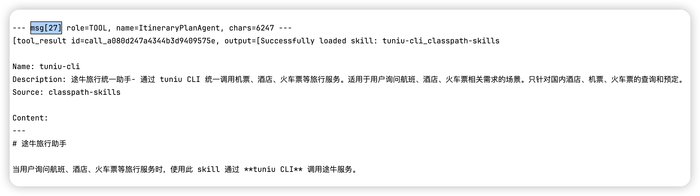
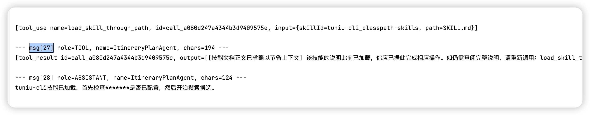

# 上下文工程——Skill正文折叠（选学）

**（需要注意，这个方案在多轮对话场景下可能会在某种程度上导致上下文缓存失效，需要结合业务场景综合来看。如果不确定是否合理，那就不要讲这个方案，或者你说之前做了这个方案，但是后面发现会导致缓存失效，后面又拿掉了，或者说别人做了这个方案，你给他优化掉了。或者是之前有些模型不支持缓存，你做了这个方案，后面换了新模型，支持了上下文缓存，然后你把这个方案废弃了。）**

Skill 真的省 Token 么？大家首先想到的肯定是省呀，因为他有渐进式披露。

但是，一旦某个 skill 被 Agent 执行过一次之后，他的内容就会出现在上下文中了，并且后续的每一次对话，也都会把之前加载过的 skill 的全文作为一条历史 MSG 再给 LLM 传一次。即使后面这个 skill 已经不在用了。

gogo-agent 中我们针对 skill 的这个问题，做了按需加载、用完即折叠。

一份 tuniu-cli SKILL.md 典型 400~600 行（约 2000~5000 token）。如果始终在上下文中，每轮 reasoning 都要重发。折叠后变为约 100 字符（~30 token），节省量随对话轮次累积——10 轮对话累计省下 20000~50000 token。

### 懒加载

ItineraryPlanAgent.java 中构建 SkillBox：

```java
private SkillBox buildPlanningSkillBox(Toolkit toolkit) {
    SkillBox skillBox = new SkillBox(toolkit);
    skillBox.registerSkill(skillRepository.getSkill("tuniu-cli"));
    ...
    return skillBox;
}
```

registerSkill 只是注册了技能的元数据和 load_skill_through_path 工具——**技能正文不会被注入 system prompt**。LLM 通过调用 `load_skill_through_path(skillId="tuniu-cli", path="SKILL.md")` 才能看到完整内容。

并且，我们在提示词中要求：

```
- **懒加载搜索技能（重要）**：搜索类 skill（如 `tuniu-cli`）必须**在本步骤开始时**才通过 `load_skill_through_path` 加载，**严禁**在最初查审批单/常驻地/偏好/政策那一批调用里提前加载。原因：技能正文加载后若长时间不用会被上下文折叠，等到真正搜索时说明已丢失，导致搜错命令或工具名。
```

这样就可以避免在还没用到这个 skill 的时候就提前加载，晚一轮加载，对话中就可以少烧一次 token。

### 自动折叠机制

`SkillContentCollapseHook` 是这个模式的核心。

SkillBox 的 `load_skill_through_path` 工具会把整份 SKILL.md（数百行）作为工具结果写入 memory。由于 ReActAgent 每轮 reasoning 都会重放整个 memory，这份静态的技能正文会在整个会话里被反复完整发送给 LLM，白白消耗 token。

完整的 skill 的内容就会被调换成以下内容：

```
"[技能文档正文已省略以节省上下文] 该技能的说明此前已加载，你应已据此完成相应操作。"
        + "如仍需查阅完整说明，请重新调用：{skillId=tuniu-cli_classpath-skills, path=references/flight.md}";
```

这个 Hook 会监听 PreReasoningEvent，改写本轮发送给 LLM 的输入消息。

**折叠策略**：

```java
private static final int KEEP_RECENT_MSGS = 10;
```

当一条技能加载结果之后已经积累了 ≥10 条后续消息时，说明 LLM 已据此完成了若干步骤，技能正文"完成使命"，会被替换为一个占位符：

```java
private String buildPlaceholder(String reloadHint) {
    return "[技能文档正文已省略以节省上下文] 该技能的说明此前已加载，你应已据此完成相应操作。"
            + "如仍需查阅完整说明，请重新调用：" + reloadHint;
}
```

**关键设计细节**：

- **只改写 inputMessages，不碰 memory**：`event.setInputMessages(newMessages)` — 下一轮若 KEEP_RECENT_MSGS 阈值不再满足（例如对话很短），原文仍可完整出现。
- **精确的重载指引**：占位符中嵌入了完整的重载命令（如 `load_skill_through_path(skillId="tuniu-cli", path="SKILL.md")`），LLM 若真需要再次查阅可自行重新加载。

比如下面的日志，第 27 条消息，前面还是完整的 skill 的内容，占用上下文的。



但是在多轮运行之后，后续的 msg 中，这条消息已经被折叠了：

