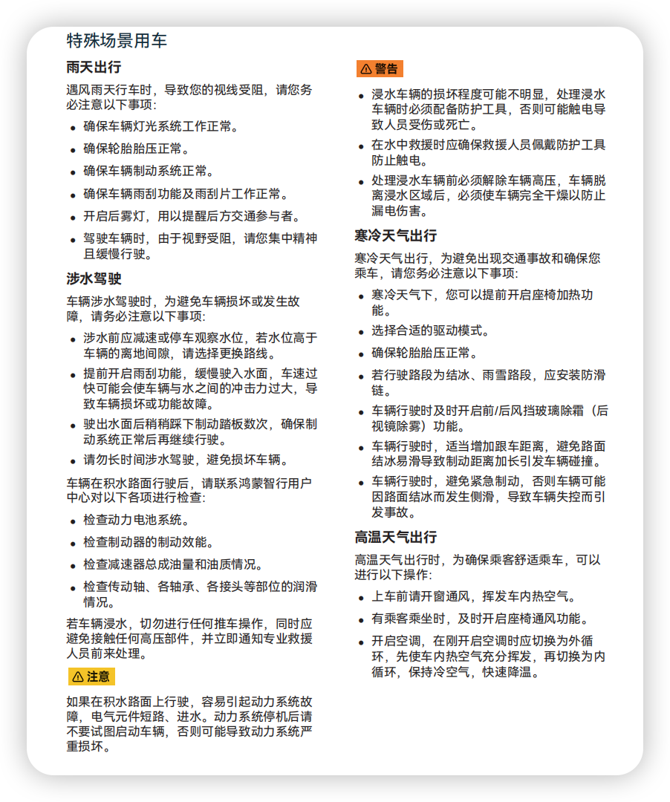
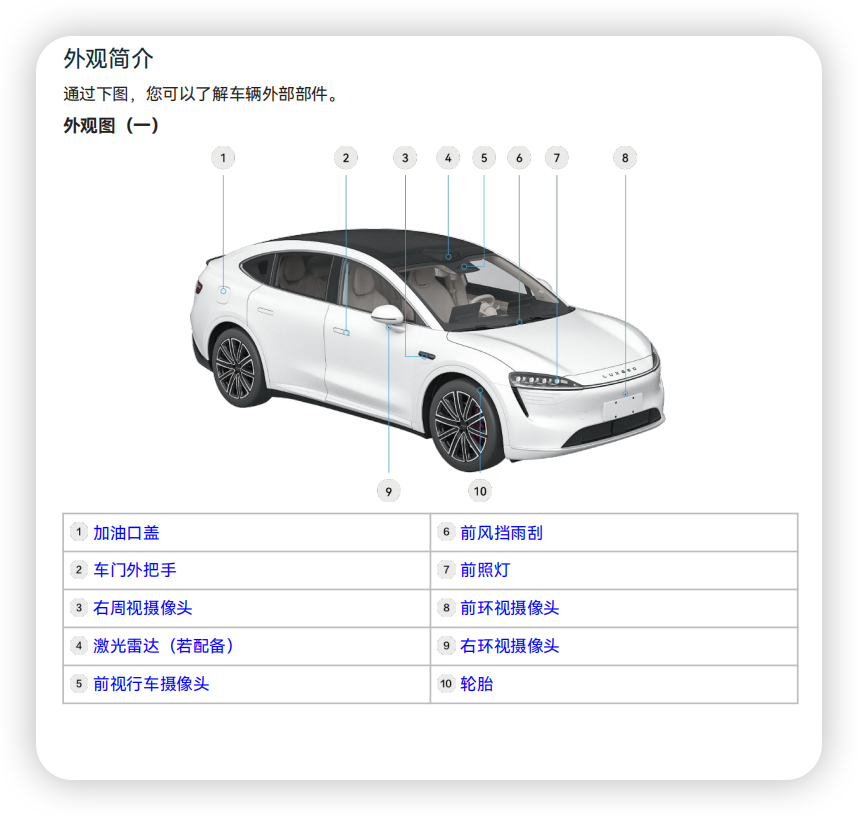
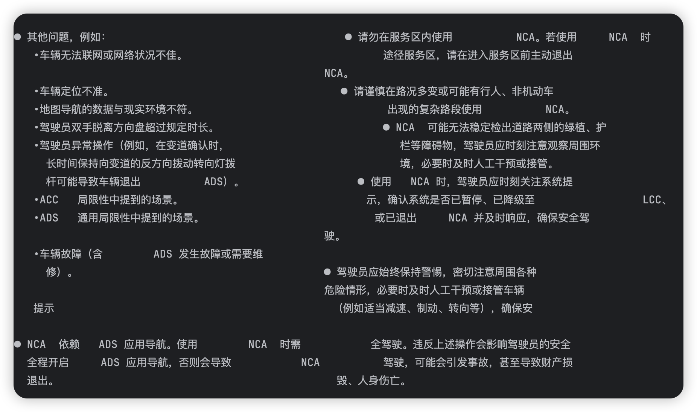
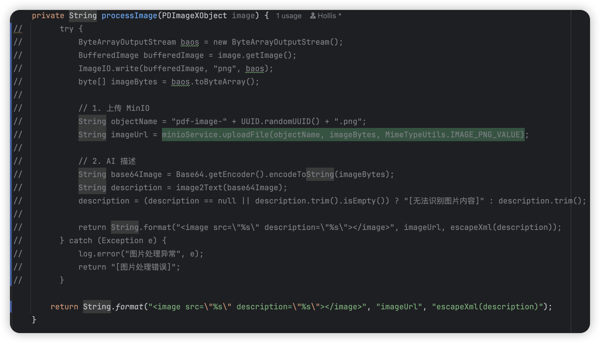
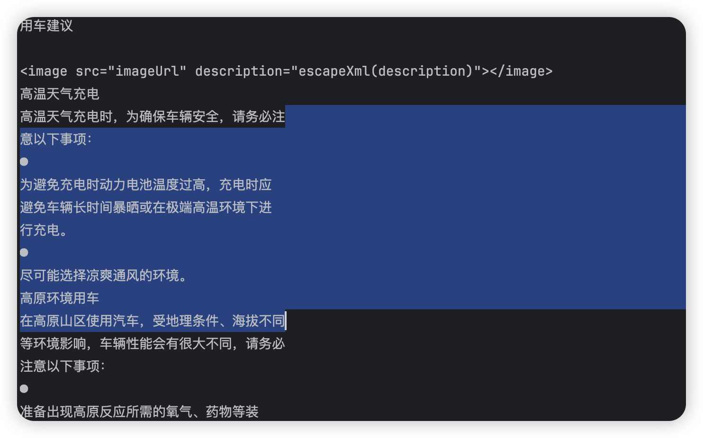
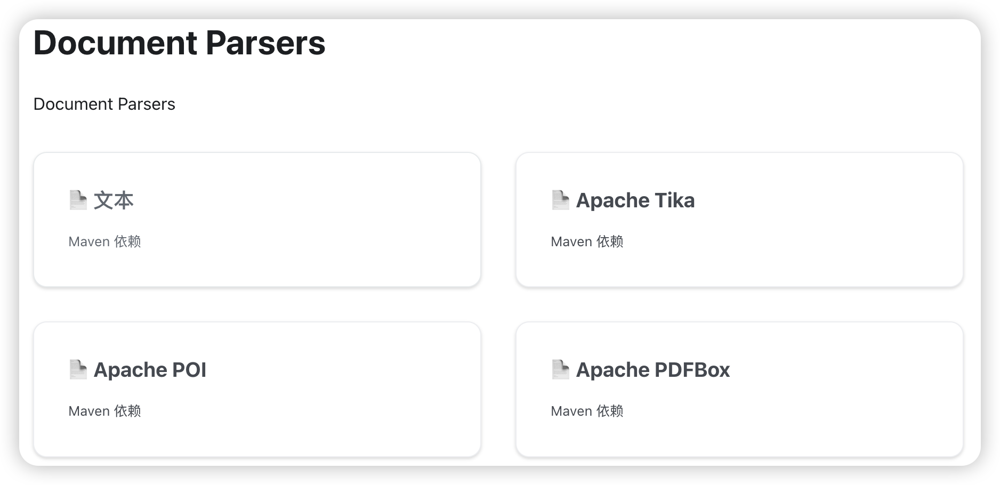
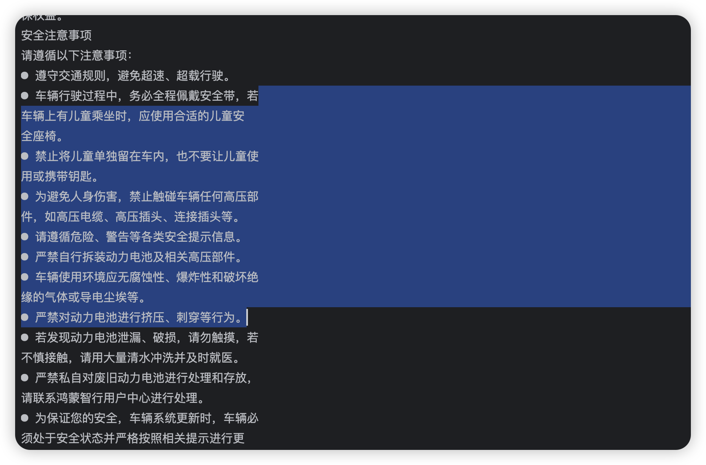

# ✅ 为什么不用 Java 解析 PDF 文档

一般的知识库内容，通常由 word、markdown、pdf 以及在线文档这几种形式。其中比较难处理的就是 pdf。

我们可以先试一下，用 spring ai 和 langchain4j 的话，处理一下 pdf，看看什么效果。

先准备一份图文并茂的 PDF：

`r7-product-manual-20250123.pdf`（46.1 MB）

（以上文档在 https://thoughts.aliyun.com/workspaces/6963289eb0fc2e001bb052eb/docs/6a847264c71a890001a0a88e 中已提供）

## Spring AI

我们之前讲 RAG 的时候，提到过 pdf 的处理，可以用 `PagePdfDocumentReader`、`ParagraphPdfDocumentReader`，我们为此还封装了一个 `PdfReaderStrategy`。

但是他解析 PDF 效果真的好吗？

我们前面准备了一份 PDF，简单预览下：





是这种文字呈现左右结构，带图片带表格的。我们写一个单测，用这个 `PdfReaderStrategy` 解析一下看看效果：

```java
package cn.hollis.llm.mentor.rag.reader;

import org.junit.jupiter.api.Test;
import org.springframework.ai.document.Document;

import java.io.File;
import java.io.IOException;
import java.util.List;

public class MarkdownReaderStrategyTest {

    @Test
    public void read() {
        PdfReaderStrategy pdfReaderStrategy = new PdfReaderStrategy();
        try {
            List<Document> documents = pdfReaderStrategy.read(new File("/Users/hollis/Desktop/r7-product-manual-20250123.pdf"));
            for (Document document : documents) {
                System.out.println(document.getText());
                System.out.println("===============");
            }
        } catch (IOException e) {

        }
    }
}
```

运行一下，就是以下这种效果。



主要问题：

1. 格式乱，左右结构并没有区分出来。
2. 有大量的空白字符。
3. 图片没有解析出来，甚至没有保留。
4. 表格没有解析出来，甚至没有保留。

当然，大家应该还记得，我们前面为了特意处理这种 PDF 的文件，给大家定义过一个 `PdfMultimodalProcessor`，他能帮我们处理带图片的 PDF，也可以写个单测运行下看看效果：

（注意，先把里面的 `processImage` 方法注释掉，跳过图片处理）



```java
@Test
public void load() throws IOException {
    PdfMultimodalProcessor pdfMultimodalProcessor = new PdfMultimodalProcessor();

    try {
        System.out.println(pdfMultimodalProcessor.processPdf(new File("/Users/hollis/Desktop/r7-product-manual-20250123.pdf")));
    } catch (Exception e) {
        throw new RuntimeException(e);
    }
}
```

得到运行结果：



图片可以处理了，但是他也有些缺点：

1. 需要自己写代码，实现功能。
2. 解析出来的文字中也有很多空格。
3. 解析出来的文档结构也不正确。
4. 表格无法处理。

## LangChain4J

那我们试试 langchain4j。他支持下面几种文档处理器，我们使用 pdfbox 的试一下。



增加依赖：

```xml
<dependency>
    <groupId>dev.langchain4j</groupId>
    <artifactId>langchain4j-document-parser-apache-pdfbox</artifactId>
    <version>1.8.0-beta15</version>
</dependency>
```

单测：

```java
import dev.langchain4j.data.document.Document;
import dev.langchain4j.data.document.DocumentParser;
import dev.langchain4j.data.document.parser.apache.pdfbox.ApachePdfBoxDocumentParser;
import org.junit.Test;

import java.io.FileInputStream;
import java.io.IOException;
import java.io.InputStream;

public class ApachePdfBoxDocumentParserTest {

    @Test
    public void test_parse_pdf_file() {
        try (InputStream inputStream = new FileInputStream("/Users/hollis/Desktop/r7-product-manual-20250123.pdf")) {
            DocumentParser parser = new ApachePdfBoxDocumentParser();
            Document document = parser.parse(inputStream);

            System.out.println(document.text());

        } catch (IOException e) {
            throw new RuntimeException(e);
        }
    }
}
```

运行结果如下：



和 Spring AI 差不多，文档的结构读取的是正确的了，该有的问题还是有。

也就是说，用 JAVA 中的工具，解析出来的文档都存在各种问题，而且除了这些问题外，还有些情况也无法处理，比如如果 PDF 是个扫描件怎么办？PDF 中有表格怎么办？PDF 中如果存在 LaTex 公式怎么办，都无能为力了。

所以，我们需要换一种能一次性解决所有问题的方案。