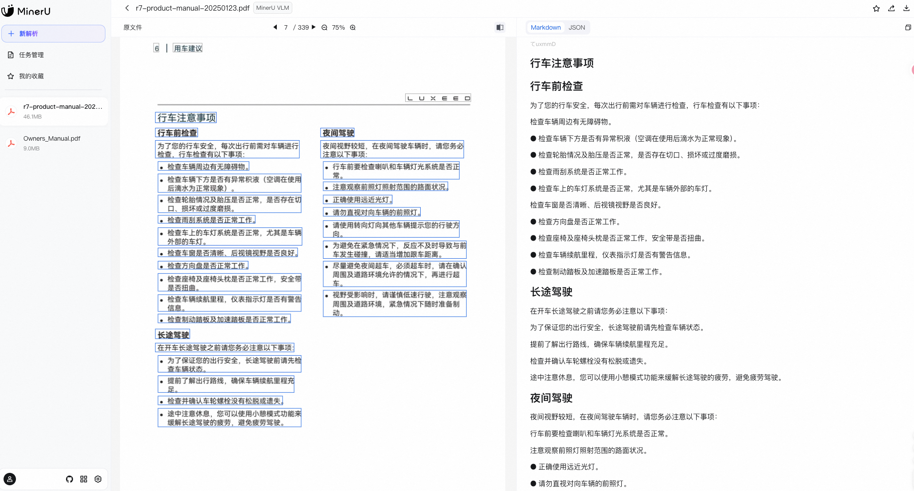
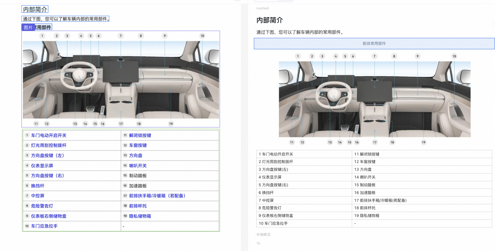
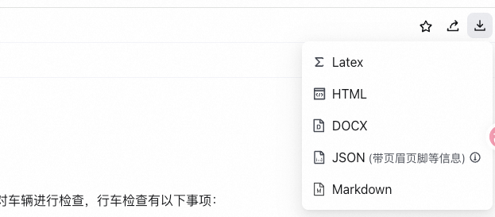

# ✅ 为什么选择 MinerU 解析文档？

我们选择使用 python 来解析文档，是因为它有很多成熟的库可以直接使用。目前，市面上比较常见的 pdf 处理的开源库有 MinerU、Marker、PaddleOCR 这几个。对比如下：

| 工具 | MinerU | PaddleOCR + PP-Structure | Marker |
| --- | --- | --- | --- |
| **类型** | 端到端智能解析 | 分阶段 OCR+版面分析 | 基于 LLM 的 PDF 转 Markdown |
| **开源** | ✅ 是 | ✅ 是 | ✅ 是 |
| **中文支持** | ⭐⭐⭐⭐⭐ | ⭐⭐⭐⭐ | ⭐⭐ |
| **公式识别** | ✅ LaTeX（高精度） | ❌ 仅字符级，无公式结构 | ⚠️ 依赖 OCR，公式支持弱 |
| **表格还原** | ✅ 支持跨页、合并单元格 | ⚠️ 基础表格，跨页易错 | ⚠️ 表格常转为图片或文本 |
| **多栏排版** | ✅ 自动还原阅读顺序 | ⚠️ 易出现"Z字形"错乱 | ✅ 较好（依赖 layout 模型） |
| **OCR 能力** | ✅ 内置多语言 OCR（84种） | ✅ 强（中文优化好） | ✅（集成 Donut/OCR） |
| **输出格式** | Markdown / JSON / HTML | TXT / HTML（需二次开发） | Markdown |
| **部署难度** | 中等（支持 CLI/WebUI/Docker） | 较高（需拼接模块） | 中等（需 GPU） |
| **适合场景** | 学术论文、财报、教材、RAG 知识库构建 | 简单票据、证件、固定模板文档 | 英文论文批量转 Markdown |

MinerU 选择的比较多，主要因为他有以下几个优势：

1. 能正确处理双栏、图文穿插、浮动框等。
2. 可高精度输出 LaTeX，适合科研场景。
3. 部署简单、方便、开源。
4. 对中文友好。
5. 可以把 PDF 转成 markdown。
6. 对表格、图片友好。
7. 提供了开源版、网页版、客户端和在线 API 多种使用方式。

- 开源地址：https://github.com/opendatalab/mineru
- 在线地址：https://mineru.net/
- API 使用：https://mineru.net/apiManage/docs

## 效果体验

可以先使用在线版看下效果，MinerU 的在线版支持用 github 或者微信登录，登录后就能免费试用。

左侧是 PDF，右侧是 markdown。

支持导出多种格式：

建议使用 Markdown。

## 缺点

MinerU 网页版的使用有一个缺点，那就是他虽然可以识别标题，但是他没办法准确的识别 PDF 中的多级标题，他会把所有标题都转成 `#` 这种 markdown 形式，也就是都转成 1 级标题。

另外，后面我们也会给大家详细介绍如何使用，使用时有个各种问题，到时候告诉大家如何解决。